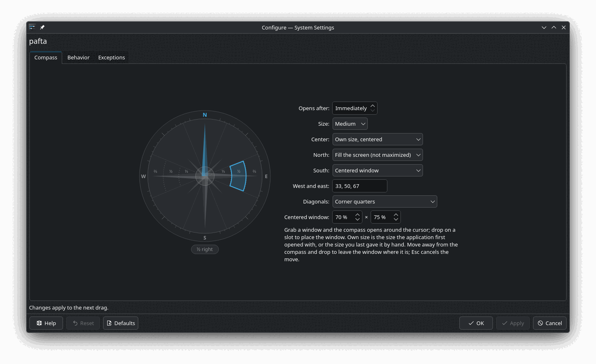

# pafta

A compass for placing windows while you drag them: a KWin script for KDE Plasma 6.


Grab a window and the compass opens under the cursor. Drop it on a slot and the window takes that place; move away and drop to leave it where it is. Plasma's own tiles (Meta+T, Shift+drag) are left as they are.

Website: https://to1un.github.io/pafta/

## Requirements

- KDE Plasma 6
- Developed and tested on Plasma 6.8 (KWin 6.8) on Wayland; X11 is untested.

## Install

```bash
git clone https://github.com/to1un/pafta
kpackagetool6 --type=KWin/Script --install pafta/package
```

Tick **pafta** in *System Settings → Window Management → KWin Scripts* and press Apply.

Update:

```bash
cd pafta && git pull
kpackagetool6 --type=KWin/Script --upgrade package
```

KWin keeps running the old code until you log out and back in.

Uninstall: untick pafta in KWin Scripts, then

```bash
kpackagetool6 --type=KWin/Script --remove pafta
```

pafta keeps remembered placements and each application's own size in `~/.local/share/pafta/state.ini`; delete it if you no longer need it.

## Usage

| Slot | Default |
|---|---|
| North | Fill the screen (not maximized) |
| South | Centered window, 70 × 75 % |
| West, east | ⅓, ½ and ⅔ of the width, full height, from the hub outwards |
| Diagonals | Corner quarters |
| Hub | Own size: the size the application first opened with, or the last size you gave it by hand |

Esc during the drag cancels the move. When an application closes, pafta remembers where it was placed and puts it back the next time it opens; un-maximized windows return to where they were.

Settings are in *KWin Scripts → pafta → configure*: when the compass opens (immediately, or after the cursor rests), its size, what the hub, north and south do, the side widths, diagonals and the centered size, plus applications to leave alone. Changes apply to the next drag.



KWin scripts cannot read modifier keys during a window move, so the compass opens by mouse only.

## License

[GPL-3.0-or-later](LICENSE). Inspired by [KZones](https://github.com/gerritdevriese/kzones) and [Remember Window Positions](https://github.com/rxappdev/RememberWindowPositions).
