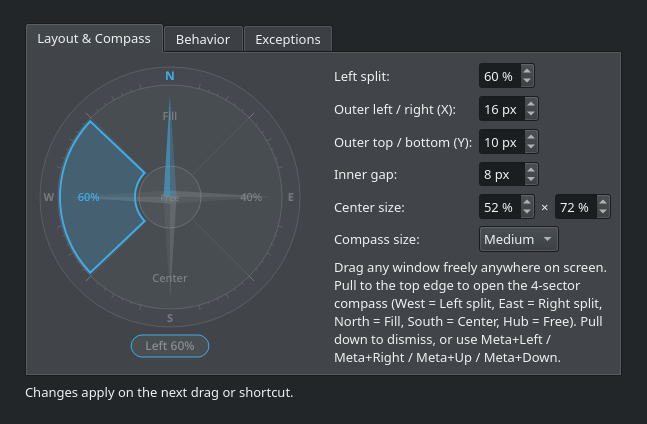

# pafta

Top-edge compass picker, `Meta+Arrow` tiling, and per-app window memory for KDE Plasma 6.


Drag any window freely anywhere on screen — nothing pops up when you pause or move mini windows. Pull a window up to the screen's top edge to open the 4-sector compass right above your cursor, or use `Meta+Arrow` shortcuts to snap immediately. Plasma's native `Meta+T` tiles are left untouched.

## Requirements

- KDE Plasma 6
- Developed and tested on Plasma 6.8 (KWin 6.8) on Wayland; X11 is untested.

## Install

```bash
git clone https://github.com/to1un/pafta
kpackagetool6 --type=KWin/Script --install pafta/package
```

Enable **pafta** in *System Settings → Window Management → KWin Scripts* and click Apply.

Update:

```bash
cd pafta && git pull
kpackagetool6 --type=KWin/Script --upgrade package
```

Reload KWin (or log out and back in) after upgrading.

Uninstall: untick pafta in KWin Scripts, then

```bash
kpackagetool6 --type=KWin/Script --remove pafta
```

pafta stores remembered window placements in `~/.local/share/pafta/state.ini`; delete it if you no longer need it.

## Usage

| Compass / Shortcut | Action | Default |
|---|---|---|
| West (`W`) · `Meta+Left` | Left column | `60%` |
| East (`E`) · `Meta+Right` | Right column | `40%` |
| North (`N`) · `Meta+Up` | Fill work area (with outer padding) | `Fill` |
| South (`S`) · `Meta+Down` | Centered floating box | `52% × 72%` |
| Hub (`Free`) / Pull down | Dismiss and leave freely placed | — |

Every move, resize, slot snap, and maximize state is saved per application and restored synchronously when the application reopens on Wayland.

Settings live in *System Settings → Window Management → KWin Scripts → pafta*: `Left split`, independent `Outer left / right (X)`, `Outer top / bottom (Y)`, `Inner gap`, `Center size`, `Compass size`, window memory, and `Exceptions`. Changes apply on the next drag or shortcut.



## License

[GPL-3.0-or-later](LICENSE). Inspired by [KZones](https://github.com/gerritdevriese/kzones) and [Remember Window Positions](https://github.com/rxappdev/RememberWindowPositions).
